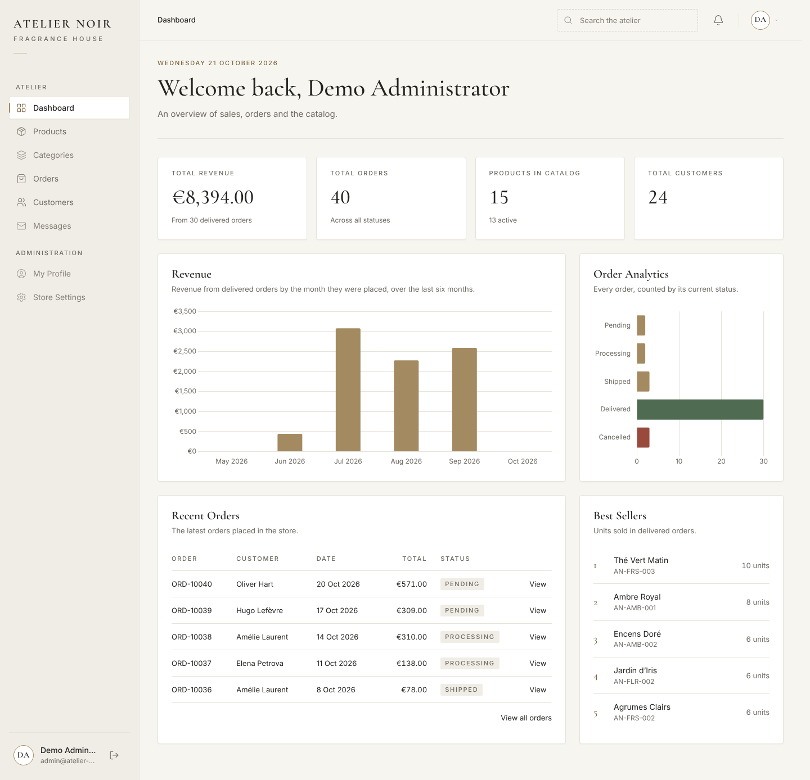
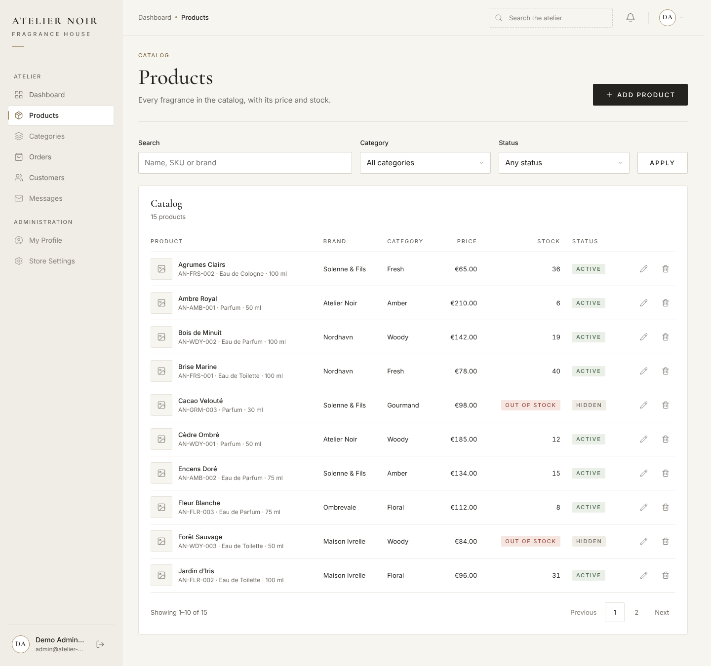
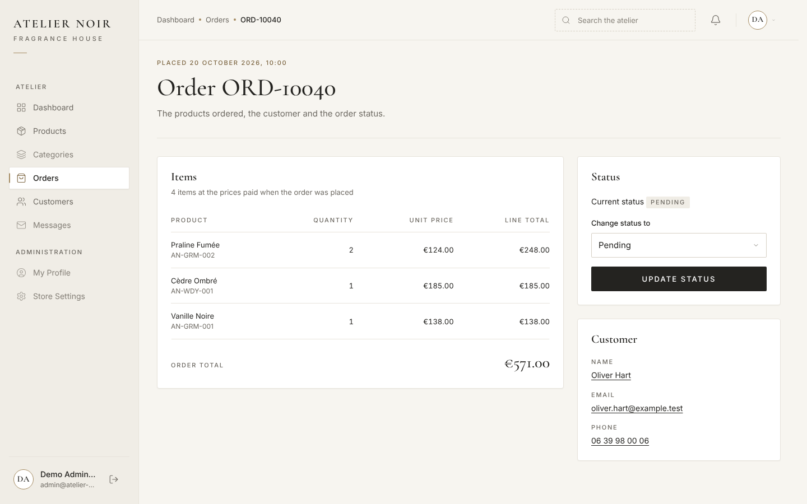
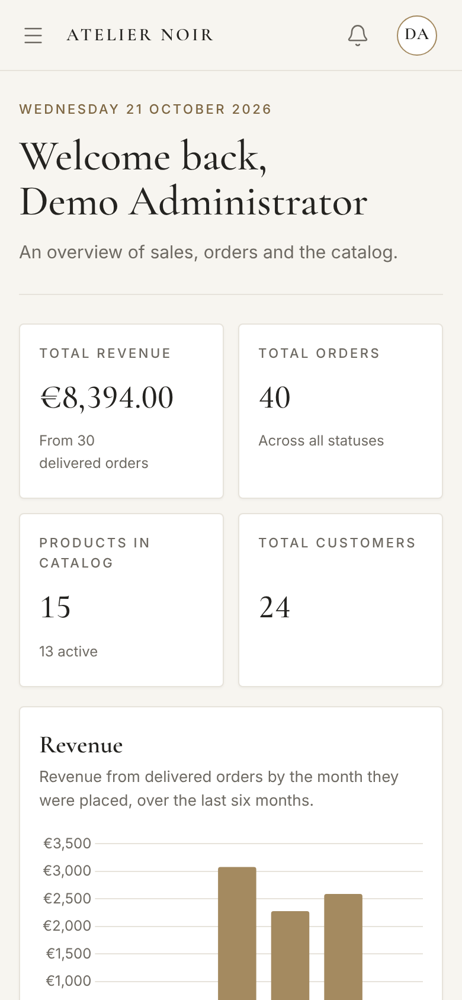

# ATELIER NOIR: Luxury Perfume Admin Panel

An admin panel for managing a luxury perfume store: product catalog, categories, orders, customers, messages and store analytics. Built as a portfolio project with Laravel and server-rendered Blade views.

> **Project status:** the main admin panel features are in place: the dashboard, products with image uploads, categories, orders, customers, the messages inbox, notifications, global search, store settings, user management with role-based access, and each user's own profile, photo and password. The project has not been deployed or tested on a production server yet.

## Features

| Area | What it covers |
| --- | --- |
| Dashboard | Key figures, revenue and order status charts (Chart.js), recent orders and best sellers, all read from the stored data |
| Products | Create, edit and delete; image upload, replacement and removal; search, category and status filters, pagination |
| Categories | Add, rename and delete categories; product counts; a category is optional on a product |
| Orders | Search, status filter, details with the prices paid, totals, status updates |
| Customers | Search by name, email or phone; details with the full order history |
| Messages | Inbox with search, read/unread filter, read status changes and deletion |
| Notifications | New orders, customers and messages in the top bar, with per-user read status |
| Global search | One search field in the top bar for products, categories, customers, orders and messages |
| Store settings | Store name, contact details and logo upload |
| User management | Store Managers add, edit and delete accounts and assign roles |
| My Profile | Edit your own name and email, upload or remove a profile photo, change your password |
| Authentication | Login, logout, login throttling, protected routes, role-based access |

## Screenshots

Screenshots of the running application with the fictional sample data described below. They were taken before categories, messages, notifications, global search, store settings and roles were added, so newer parts of the interface are not shown.

**Dashboard:** key figures, revenue and order charts, recent orders and best sellers.



**Products:** the catalog with search, filters, stock and status.



**Order details:** the ordered items at the prices paid, the order total, the status form and the customer.



**Dashboard on a phone:**



## Roles and permissions

Every account has one of three roles. Each section of the panel is protected by a gate (`access-<section>`, defined in `bootstrap/app.php` from `User::SECTION_ROLES`) and by `can:` middleware on its routes:

| Section | Store Manager | Admin | Seller |
| --- | --- | --- | --- |
| Dashboard | Yes | Yes | No |
| Products | Yes | Yes | Yes |
| Categories | Yes | Yes | No |
| Orders | Yes | Yes | Yes |
| Customers | Yes | Yes | No |
| Messages | Yes | Yes | Yes |
| Store Settings | Yes | No | No |
| User Management | Yes | No | No |

- Opening a section the role may not use returns **HTTP 403 Forbidden**. The sidebar only lists the sections the signed-in user may open.
- Every role can use My Profile, global search, notifications and logout. Search results and notifications only include the sections the user may open.
- Where a page links to another section (for example an order's customer), the link is only shown to roles that may open it.
- After login, users go to the page they originally asked for if their role may open it; otherwise to their role's home page. The home page is the dashboard, or **Products** for roles without the dashboard, so Sellers start on Products.
- The last Store Manager cannot be demoted or deleted, so the panel always keeps one.
- Nobody can delete their own account; another Store Manager has to do it.
- The role is not mass assignable (`User` model): User Management sets it after these checks, and the demo seeder sets it for the demo account. New database rows default to `seller`, the most limited role.

## Technology stack

- **Backend:** PHP 8.3+, Laravel 13
- **Frontend:** Blade templates, HTML, custom CSS and vanilla JavaScript, bundled with Vite. Chart.js draws the dashboard charts and is loaded only on pages that have a chart. No CSS or JS framework.
- **Typography and icons:** Cormorant Garamond and Inter (self-hosted via Fontsource), Lucide icons as inline SVG
- **Database:** MySQL 8.4 (target). Automated tests run on SQLite in memory by default, and can also run against MySQL.
- **File storage:** Laravel's `public` disk (`storage/app/public`) for product images, the store logo and profile photos
- **Testing and quality:** PHPUnit 12, Laravel Pint

## Prerequisites

- PHP 8.3 or newer with the `pdo_mysql`, `pdo_sqlite`, `mbstring`, `openssl`, `fileinfo` and `intl` extensions (`intl` formats prices and figures), plus `gd` for the test suite (it creates fake images)
- Composer 2
- Node.js 22.13+ and npm
- MySQL 8.4, either installed locally or through Docker (a `compose.yaml` is included)

## Local setup

```bash
git clone https://github.com/lhastil/ATELIER-NOIR-luxury-perfume-dashboard-.git
cd ATELIER-NOIR-luxury-perfume-dashboard-

composer install
npm install

cp .env.example .env
php artisan key:generate
php artisan storage:link
```

`php artisan storage:link` creates `public/storage`, a link to `storage/app/public`, so uploaded product images, logos and profile photos can be shown in the browser. Without it, uploads are saved but their images do not load. The link is excluded by `.gitignore`.

### Environment configuration

`.env.example` contains placeholders only. In your `.env`, set the database values for your MySQL server. Always choose your own password:

```dotenv
DB_CONNECTION=mysql
DB_HOST=127.0.0.1
DB_PORT=3306
DB_DATABASE=atelier_noir
DB_USERNAME=atelier
DB_PASSWORD=choose-a-local-password
```

`APP_URL` must be the address you open the panel at (for example `http://localhost:8000` with `php artisan serve`), because the addresses of uploaded images are built from it.

Never commit `.env`. It is excluded by `.gitignore`.

### MySQL with Docker (optional)

`compose.yaml` starts a MySQL 8.4 server that uses the `DB_*` values from your `.env`:

```bash
docker compose up -d --wait mysql
```

On first start it creates two databases:

- `atelier_noir`, for development
- `atelier_noir_testing`, used only by `composer test:mysql`, so test runs never touch development data

Data is stored in a named Docker volume (`<project-directory>_mysql-data`). `docker compose down` stops the server and keeps the data; `docker compose down -v` also deletes it.

The databases are only created when the volume is first initialised. If `composer test:mysql` reports an unknown `atelier_noir_testing` database (for example after changing `.env` on an existing volume), run `docker compose down -v` and start the server again. This deletes local MySQL data.

> If Docker Hub rate-limits the image download, pull the official image from Google's mirror and tag it locally:
> `docker pull mirror.gcr.io/library/mysql:8.4 && docker tag mirror.gcr.io/library/mysql:8.4 mysql:8.4`

### Database migrations and seeding

```bash
php artisan migrate
php artisan db:seed
```

Seeding creates the default product categories, the demo administrator described below and the sample catalog, customers and orders. It can be run again safely: nothing is duplicated, products you have edited are not overwritten, and order statuses you have changed are kept. Running it again does reset the demo administrator's name, password and role to the values below.

In production (`APP_ENV=production`), the demo administrator and all sample data seeders skip themselves, so a full `php artisan db:seed --force` creates only the five categories there. See [Running in production](#running-in-production) for the production steps.

### Sample data

The seeded catalog, customers and orders are **sample data for demonstration**:

- 15 fictional perfumes from fictional brands, spread over five categories (Floral, Woody, Amber, Fresh and Gourmand), with no images. There are no real products, prices or stock levels.
- 24 fictional customers. Email addresses use the reserved `example.test` domain. Phone numbers come from the `06 39 98` block that Arcep, the French telecoms regulator, reserves for films and other fiction; they are stored in international format (`+33639980001`) and shown in the French format (`06 39 98 00 01`). Customer search finds a phone number typed with or without spaces, and with either `06…` or `+33 6…`. Three customers have no orders yet.
- 40 orders (`ORD-10001` to `ORD-10040`) with one to three items each, across every order status. Order dates count back up to 118 days from the day the orders are first seeded.

There are no sample messages, and no store settings are seeded: the Store Settings page starts empty until it is first saved.

Records created or changed in the panel are stored the same way and behave exactly like the seeded ones.

- `database/seeders/CategorySeeder.php`: the five default categories. Administrators can add, rename or delete categories in the panel afterwards; running the seeder again leaves existing categories untouched.
- `database/seeders/SampleProductSeeder.php`: the sample products (`php artisan db:seed --class=SampleProductSeeder`, which also seeds the categories). Sample products are matched by SKU, so if you change a sample product's SKU in the panel, the next seed run adds the original sample again.
- `database/seeders/CustomerSeeder.php`: the sample customers, matched by email.
- `database/seeders/SampleOrderSeeder.php`: the sample orders (`php artisan db:seed --class=SampleOrderSeeder`, which also seeds the customers, products and categories). Orders are matched by number, and items are added only when an order is first created.

### Demo administrator (local only)

| | |
| --- | --- |
| Email | `admin@atelier-noir.test` |
| Password | `atelier-demo` |
| Role | Store Manager (access to every section) |

These credentials are published in this README on purpose, so anyone can try the project locally. They are for local demonstration only: never use them, or this account, on a real or publicly reachable installation. The seeder (`database/seeders/DemoAdminSeeder.php`) refuses to run when `APP_ENV=production`, and the password is stored hashed like any other.

To create only this account: `php artisan db:seed --class=DemoAdminSeeder`. Running it again resets the account's name, password and role to the values above.

To try the other roles, sign in as the demo administrator and add an Admin or Seller account under **User Management**.

### Running the application

```bash
npm run build          # or `npm run dev` for hot reloading
php artisan serve
```

Then open <http://localhost:8000> and sign in with the demo administrator. Every admin page requires signing in; there is no public registration.

## Running in production

These are the steps this project needs on a conventional PHP host (a server or hosting plan where you control the web server, PHP and a shell). It is not a complete hosting guide, and no hosting provider has been chosen. All values below are placeholders: replace them with your own.

**Requirements.** PHP 8.3+ with the extensions listed under [Prerequisites](#prerequisites) (`gd` and `pdo_sqlite` are only needed for the test suite), Composer 2, a MySQL-compatible database, and Node.js 22.13+ with npm to build the assets. The assets can also be built on another machine and uploaded as `public/build`.

**1. Environment.** Copy `.env.example` to `.env` and set at least:

```dotenv
APP_ENV=production
APP_DEBUG=false
APP_URL=https://admin.your-domain.example

DB_CONNECTION=mysql
DB_HOST=your-database-host
DB_PORT=3306
DB_DATABASE=your-database-name
DB_USERNAME=your-database-user
DB_PASSWORD=your-database-password
```

- `APP_DEBUG=false` keeps error pages from showing stack traces and configuration details.
- `APP_URL` must be the exact public address of the panel, including `https://`: the addresses of uploaded product images, logos and profile photos are built from it.
- **Time zone:** the application runs in UTC (`config/app.php`), and `config/database.php` sets the MySQL session time zone to `DB_TIMEZONE`, which defaults to `+00:00`. Leave `DB_TIMEZONE` unset, or keep it equal to the application's time zone; otherwise times stamped by the database and by Laravel disagree, which shows up, for example, as notifications that never become read. After deploying, `SELECT @@session.time_zone, NOW();` through the application's database user should show UTC.
- **Database TLS:** if your database requires TLS, set `MYSQL_ATTR_SSL_CA` to the path of its CA certificate, relative to the project root. The repository includes Let's Encrypt's public ISRG Root X1 certificate, `config/certs/isrgrootx1.pem`, used for example by TiDB Cloud. When the setting is present, the server's certificate is always verified.
- **Behind a reverse proxy or load balancer:** set `TRUSTED_PROXIES` (read by `bootstrap/app.php`) to the proxy addresses, or `*` only if the server is reachable exclusively through the proxy, so links use `https` and the login throttle sees the real client IP.
- Keep the `.env.example` defaults `SESSION_DRIVER=database` and `CACHE_STORE=database` unless you have another store.

**2. Web server and file permissions.**

- Point the web server's document root to Laravel's `public/` directory, never to the project root, so `.env`, the source code and `storage/` are not reachable from the web.
- `storage/` and `bootstrap/cache/` must be writable by the web server's user.
- `storage/app/public` holds every uploaded file (`products/`, `store-logos/`, `profile-photos/`). It must persist across deployments: if each release is a fresh copy of the code, keep this directory in a shared location outside the release, and include it in your backups together with the database.

**3. Dependencies, assets and application key.**

```bash
composer install --no-dev --optimize-autoloader
npm ci
npm run build
php artisan key:generate --force   # first deployment only: a new key signs everyone out
php artisan storage:link           # creates public/storage; once per installation
```

**4. Database and caches.** Back up the database before every deployment that includes migrations. On an existing installation, read [Upgrading an existing installation](#upgrading-an-existing-installation) first.

```bash
php artisan migrate:status                           # shows which migrations will run
php artisan migrate --force
php artisan db:seed --class=CategorySeeder --force   # optional: the five default categories
php artisan optimize                                 # caches configuration, routes and views
```

Run `php artisan optimize` again after every deployment and after changing `.env`, because the cached configuration is used instead of `.env`.

The sample catalog, customers and orders are fictional and do not belong on a real installation. Their seeders refuse to run when `APP_ENV=production`, but seeding only `CategorySeeder` makes that explicit. Products do not need a category, so the categories can also be created in the panel instead.

**5. First Store Manager.** The demo administrator is never created in production. Create your own account with Tinker:

```bash
php artisan tinker
```

```php
$password = Str::password(20);
$user = new App\Models\User(['name' => 'Store Manager', 'email' => 'manager@your-domain.example', 'password' => $password]);
$user->forceFill(['role' => 'store_manager'])->save();
echo $password;
```

The role is set with `forceFill()` because it is deliberately not mass assignable: `User::create([...])` alone would create a **Seller**, the database default, who cannot open User Management or Store Settings. The valid roles are `store_manager`, `admin` and `seller` (`User::ROLES`).

The `User` model hashes the password when it is saved. The password is generated inside Tinker and printed once, so it is never typed into your shell or Tinker history. Store it in a password manager straight away. After signing in, the Store Manager can add the other accounts under **User Management**, and every user can change their own password on the **My Profile** page (`/profile`), which asks for the current password first. That page only ever changes the signed-in account; it cannot change another user's password, and User Management does not set passwords for existing accounts. If the password is lost and nobody can sign in, set a new one with Tinker: generate `$password` as above, then run `App\Models\User::where('email', 'manager@your-domain.example')->first()->update(['password' => $password]);`.

### Upgrading an existing installation

Installations set up before the latest changes need eight new migrations (`2026_11_11_000001` to `2026_11_12_000003`). Before running them:

1. **Back up the database**, and keep the backup until the upgrade is checked. On MySQL and TiDB each schema change commits immediately, so a migration that stops part-way cannot be rolled back automatically.
2. **Check the legacy `product_images` table.** Earlier versions stored product images in the database. The migration `2026_11_11_000002_move_product_images_to_files` adds `products.image_path` and drops `product_images`, but it does **not** copy images: while `product_images` still contains rows, it stops with an error before changing anything, so no image is lost silently. Inspect the table first:

   ```sql
   SELECT id, product_id, mime_type, LENGTH(data) AS bytes, created_at FROM product_images;
   ```

   Decide for each remaining image whether it is still needed. An image you want to keep has to be saved as a file under `storage/app/public/products/` and its relative path set in `products.image_path` (there is no built-in export command); images you no longer need can be removed, but only after the backup and this review. Then run the migrations.
3. **Roles.** The migration `2026_11_12_000002_add_role_to_users_table` makes every existing user a **Store Manager**, so nobody loses access during the upgrade. Afterwards, review the accounts under **User Management** and give each the role they should have.
4. Run `php artisan storage:link` if the installation does not have `public/storage` yet.

## Testing and quality checks

```bash
composer test          # PHPUnit on SQLite in memory (fast, no server needed)
composer test:mysql    # the same suite against MySQL, using the atelier_noir_testing database
vendor/bin/pint --test # code style check (run `vendor/bin/pint` to fix)
npm run build          # production asset build
```

`composer test:mysql` uses the host, port and credentials from `.env`, and needs the MySQL server (for example `docker compose up -d --wait mysql`) and the `atelier_noir_testing` database to exist.

Run tests through these Composer scripts, which clear any cached configuration first. As a safeguard, the test suite refuses to start unless it is connected to an in-memory or `*_testing` database, so it can never reset development data. Uploads in tests use Laravel's fake storage, so no real files are written.

The suite contains 238 feature tests in `tests/Feature`, covering every section, the role permissions and the data migrations.

## Project structure

Standard Laravel layout, plus:

- `resources/css/base/`: design tokens (`tokens.css`), fonts and global styles
- `resources/css/layout/`: application shell, sidebar and top navigation
- `resources/css/components/`: styles for shared layout and content components, the notifications menu (`notifications.css`) and the global search (`search.css`)
- `resources/css/pages/`: page-specific layout (dashboard, login, products, orders, messages, and `profile.css` for the My Profile page)
- `resources/js/ui/`: navigation drawer, dropdown, scrollable-table, image preview, delete-confirmation, dashboard chart, global search (`global-search.js`), notifications (`notifications.js`) and password show/hide (`password-toggle.js`) behaviour (vanilla JavaScript)
- `resources/views/components/`: Blade components (`layouts/admin`, `admin/*`, `form/*`, `icon`, `avatar`, `badge`, `flash`, `dropdown`, `page-header`, `card`, `stat-card`, `chart-panel`, `empty-state`, `table`)
- `resources/views/products/`, `categories/`, `customers/`, `orders/`, `messages/`, `search/`, `settings/`, `users/`: the admin pages
- `resources/views/profile/`: the My Profile page, with separate forms for the profile, the profile photo and the password
- `app/Http/Controllers/`:
  - `ProductController`, `CategoryController`, `OrderController`, `CustomerController`, `MessageController`, `DashboardController`: the sections
  - `SearchController`: global search (`GET /search`)
  - `NotificationController`: marks notifications as read (`POST /notifications/read-all`, `POST /notifications/{type}/{id}/read`)
  - `StoreSettingController`: Store Settings (`GET` and `PATCH /settings`)
  - `UserController`: User Management (list, add, edit, delete)
  - `ProfileController`: shows the signed-in user's profile (`GET /profile`), saves their name and email (`PATCH /profile`), changes their password (`PUT /profile/password`) and replaces or removes their photo (`PUT` and `DELETE /profile/photo`); the account always comes from the session, never from the form
  - `Auth/LoginController`: login, throttling and the redirect after login
- `app/Http/Requests/`:
  - `ProfileRequest.php`: validates the name and email (the email must be unique, but the user's own current address is accepted)
  - `PasswordRequest.php`: validates a password change (the current password must be correct, and the new one must be confirmed and meet Laravel's default password rules)
  - `ProductRequest.php`, `CategoryRequest.php`, `StoreSettingRequest.php`, `ProfilePhotoRequest.php`, `UserRequest.php`: validation for the other forms (`UserRequest` also checks that the user is a Store Manager)
- `app/View/Composers/NotificationsComposer.php`: builds the notification list and unread count for the top bar
- `app/Http/Middleware/PreventSearchIndexing.php` and `public/robots.txt`: ask search engines not to index the panel (`X-Robots-Tag: noindex, nofollow`)
- `tests/Feature/`: feature tests, for example `ProfileTest.php` for the profile and password forms and `RoleAccessTest.php` for the permissions table
- `compose.yaml`: local MySQL server
- `docker/mysql/init/`: one-time MySQL initialisation (creates the testing database)

## Database relationships

The Eloquent relationships defined in `app/Models`:

| Model | Relationship | Purpose |
| --- | --- | --- |
| `Category` | `products()`: has many `Product` | The products in a perfume family. |
| `Product` | `category()`: belongs to `Category` (optional) | The family a product is listed under, or none ("No category"). A category cannot be deleted while products use it. |
| `Customer` | `orders()`: has many `Order` | A customer's order history. A customer cannot be deleted while they have orders. |
| `Order` | `customer()`: belongs to `Customer` | Who placed the order. |
| `Order` | `items()`: has many `OrderItem` | The product lines of the order; they are deleted together with the order. |
| `OrderItem` | `order()`: belongs to `Order` | The order the line belongs to. |
| `OrderItem` | `product()`: belongs to `Product` | The catalog product, used to link to it. It is empty once the product has been deleted. |
| `Message` | `customer()`: belongs to `Customer` (optional) | The customer who sent the message, if known. The message keeps its own name and email, and the link is cleared if the customer is deleted. |

Each order item keeps its own copy of the product name, SKU and unit price from when the order was placed, so editing or deleting a product never changes an existing order.

Other tables without relationships:

- `store_settings`: a single row with the store name, contact email, phone, address and logo path (`StoreSetting::current()`).
- `users`: besides name, email and password, each user has a `role`, an optional `profile_photo_path` and `notifications_read_at` (the last time they used "Mark all as read").
- `notification_reads`: one row per user and opened notification (`user_id`, `type` of `order`, `customer` or `message`, and `record_id`), unique per combination. Rows are deleted together with their user.

## Business rules

- **Prices** are shown in euros. The currency is set once, with `APP_CURRENCY` in `.env` (read in `config/app.php`).
- **Uploaded files** are stored on Laravel's `public` disk (`storage/app/public`) under a random name chosen by Laravel; the database stores only the relative path. Product images, the store logo and profile photos each accept JPEG, PNG or WebP files up to 2 MB, and the file extension is chosen from the file's content, not the name it was sent with.
- **Product images** are stored in `products/`, with the path in `products.image_path`. Uploading a new image replaces the old one, and the product form can also remove the image. The old file is deleted only after the product has been saved with its new image (or none); if saving fails, the new upload is deleted and the product keeps its previous image. Deleting a product deletes its image file.
- **Product categories** are optional: a product can be saved with "No category". Category names are unique and up to 60 characters. A category that still has products cannot be deleted; move its products to another category, or set them to "No category", first.
- **Order statuses** are `pending`, `processing`, `shipped`, `delivered` and `cancelled` (`Order::STATUSES`). Any role that can open Orders can set any of them on the order page; other values are rejected. Changing a status does not change product stock.
- **Order totals** are always calculated from the stored order items (quantity × unit price, added up in whole cents); no separate total is stored.
- **Revenue** counts only orders with the status `delivered` (`Order::delivered()`); pending, processing, shipped and cancelled orders are excluded. It is added up in whole cents from the order items' stored quantities and unit prices, and formatted in euros only for display.
- **Revenue month:** there is no delivery date, so a delivered order's revenue is counted in the month the order was **placed** (`placed_at`), not the month it was delivered.

### Messages

Each message has a sender name and email, a subject, a body, an optional link to a customer and a read status (`read_at`). The inbox lists messages ten per page and can be searched by name, email or subject and filtered by read or unread. Opening an unread message marks it as read; it can then be marked unread again, or deleted.

There is no public contact form and no message seeder yet: messages currently have to be inserted directly into the `messages` table.

### Notifications

The bell in the top bar lists the eight newest new orders, new customers and new messages, limited to the sections the user's role may open. Its badge counts every unread notification in those sections, not only the eight listed.

- An item is **unread** for a user when it was created after that user last used "Mark all as read" (or, if they never did, after their account was created) and they have not opened it from the notifications menu.
- Clicking a notification records it in `notification_reads` for that user and opens the order, customer or message.
- **Mark all as read** stores the current time in the user's `notifications_read_at` and clears their `notification_reads` rows; it updates the menu without reloading the page.
- Read status is per user: one user reading a notification does not change it for others. It is also separate from a message's own read status in the inbox.

### Global search

The search field in the top bar searches with at least two characters. It returns up to five results in each group, and only for the sections the user's role may open:

| Group | Searched in |
| --- | --- |
| Products | name and SKU |
| Categories | name |
| Customers | name, email and phone number (as in the customer list) |
| Orders | order number |
| Messages | sender name, email and subject |

Results appear below the field while typing; pressing Enter opens the full results page (`/search?q=…`). Products, categories, customers, orders and messages also keep their own search on their list pages.

### Store settings and profile photos

- **Store Settings** (Store Managers only) holds the store name and contact email (both required), an optional phone number and address, and a logo. The logo is shown on the Store Settings page; the rest of the panel does not display it yet. Uploading a new logo replaces the previous one and deletes its file; there is no option to remove the logo without replacing it.
- **Profile photo:** every user can upload a photo on My Profile, shown in their avatar. A new photo replaces the old one, whose file is deleted once the account points to the new one. Removing the photo clears it from the account and deletes the file.

### User management

Store Managers can list, add, edit and delete accounts. A new account needs a name, a unique email, a role and a password that meets Laravel's default password rules. Editing an account changes its name, email and role, but never its password. See [Roles and permissions](#roles-and-permissions) for the protections on the last Store Manager and on deleting your own account.

### Dashboard figures

All figures are read from the database on each visit; nothing is stored or cached.

| Section | Rule |
| --- | --- |
| Total Revenue | Revenue from every delivered order, all time. |
| Total Orders | Every order, in all five statuses. |
| Products in Catalog | Every product, hidden ones included; the number of active products is shown below it. |
| Total Customers | Every customer. |
| Revenue chart | Delivered revenue per calendar month of `placed_at` (UTC) for the last six months, including the current month. Months without delivered orders show €0. |
| Order Analytics | The number of orders in each status, in the fixed order pending, processing, shipped, delivered, cancelled, including statuses with no orders. |
| Recent Orders | The five newest orders by `placed_at`, newest first (the most recently created first when two have the same time). |
| Best Sellers | The five products with the most units in **delivered** orders, grouped by the SKU stored on the order item and shown with its stored product name, so products deleted since still count. If a product was renamed between orders, the name from its most recently placed delivered order is shown (the most recently created order or item when two share a time). Ties in units are ordered by SKU. |

The key figures show their real value, including `0` and `€0.00`. The charts and lists show an explanatory empty state when they have nothing to display. Each chart also lists its figures in a table for screen readers, and chart animation is switched off when the system asks for reduced motion. Without JavaScript, or if the chart script cannot be loaded, each chart panel shows a short note and its figures as a visible table instead.

## Design system

All colours, type sizes, spacing (4px scale), radii, shadows and motion timings are CSS custom properties in `resources/css/base/tokens.css`. The palette follows the ATELIER NOIR specification. Two darker shades of the specified secondary text and gold colours (`--color-text-secondary`, `--color-accent-strong`) are used for small text so that it meets WCAG AA contrast. The specified `#858078` and `#A48A60` are kept for large text, icons and decoration.

The layout has three breakpoints: desktop (1024px and up) with a persistent 248px sidebar, tablet (768–1023px) and mobile (below 768px), where the sidebar becomes an accessible slide-in drawer. Transitions are 150–220ms and are switched off when the user prefers reduced motion.

## License

Copyright (c) 2026 Hasti Ahmadi. All rights reserved. This project is proprietary and is not open source: the source code may be viewed for personal evaluation and educational review, but it may not be used, copied, modified, distributed, published or commercially exploited without prior written permission from the copyright holder. See [LICENSE](LICENSE) for the full terms.

Third-party dependencies and assets remain subject to their own licenses. Third-party fonts, icons and the Chart.js library are listed in [THIRD_PARTY_NOTICES.md](THIRD_PARTY_NOTICES.md).

## Known limitations

- The dashboard has no date filter or comparison with earlier periods. The sample orders are dated relative to the day they were first seeded, so as time passes their revenue moves out of the six-month chart.
- The all-time revenue is a single database sum, but the revenue chart still loads the delivered orders of the last six months with their items, which would need a database-level sum for a very large order history.
- Authentication covers login, logout, user management and changing your own profile and password: there is no public registration, password reset or "remember me". Changing a password does not sign out other browsers where the account is already signed in. Locally, the seeder creates the demo administrator; in production, the first Store Manager is created with Tinker (see [Running in production](#running-in-production)).
- Messages have no public contact form or seeder; they currently have to be added to the database directly.
- Searches use SQL `LIKE`, so `%` and `_` in a search act as wildcards. Accent matching also differs between databases: MySQL treats "cedre" and "Cèdre" as a match, SQLite does not.
- Customers and orders are read-only apart from the order status: there are no pages to add, edit or delete them, and orders come only from the seeder or the database.
- The store logo is only shown on the Store Settings page, and it can be replaced but not removed there.
- Uploaded files live on the server's disk (`storage/app/public`). They need persistent, backed-up storage, and a setup with several web servers would need shared storage or an object storage service instead.
